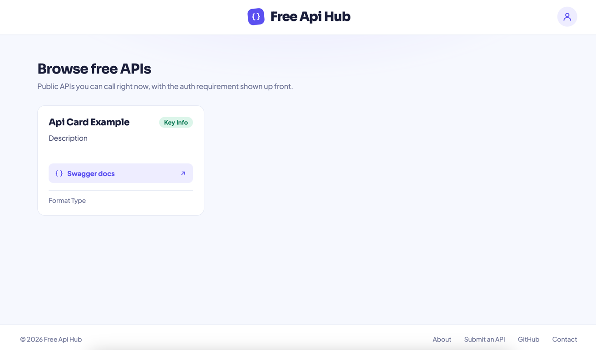
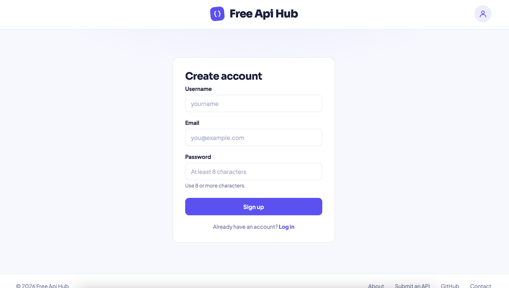
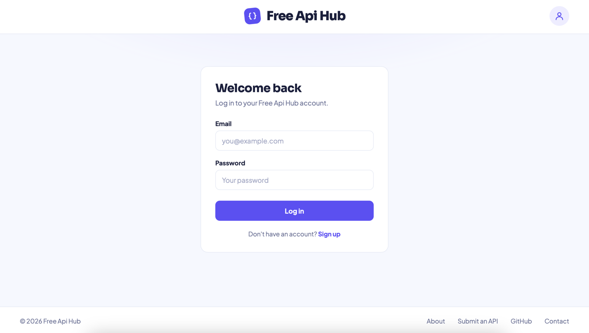

## *Global*

Added the first three web pages.

 - The first page is **"index.htmp"** page or the **main page**. On this page users are prompted to select
an API, review it Swagger documentation and proceed to the registration page:

 - The second page is **register.html** page or the **registration page**. 
On this page users can register:

- The third page is **login.html** page or the **login page**.
On this page users can authenticate and sing in to their accounts:

---

